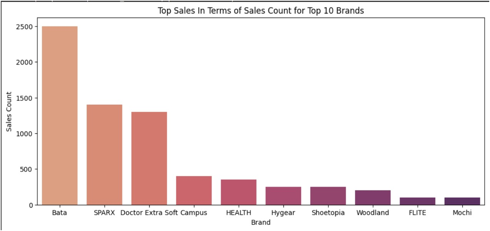
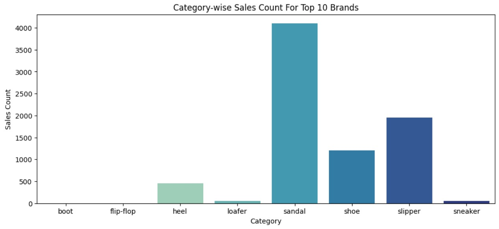
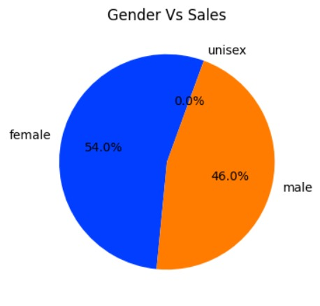
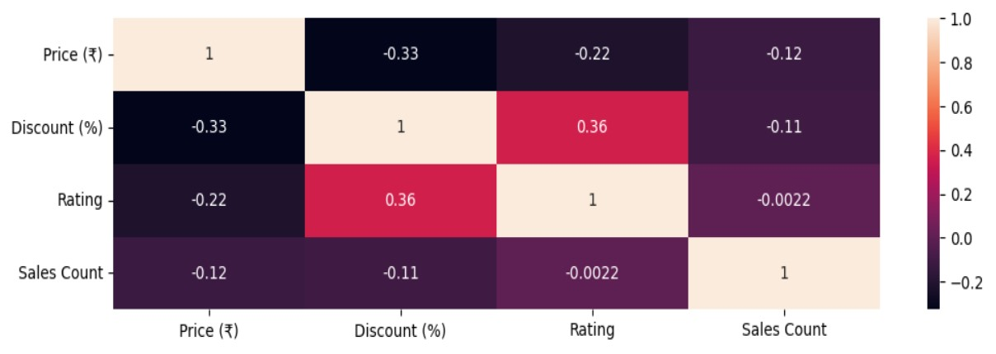

# 👟 Amazon Footwear Exploratory Data Analysis

### From Web Scraping to Data-Driven Business Decisions

**Python | BeautifulSoup | Pandas | NumPy | Matplotlib | Seaborn | EDA**

An end-to-end data analytics project exploring Amazon India's footwear market through web scraping, data cleaning, exploratory data analysis, and visualization to identify sales patterns and provide actionable recommendations for new sellers.

---

## 📌 Project Overview

With hundreds of footwear brands competing on Amazon, choosing the right products, pricing strategy, and target customers can be challenging for a new seller.

This project analyzes **910 Amazon footwear product listings** to understand brand performance, customer preferences, pricing patterns, ratings, discounts, and product categories.

The objective is to transform unstructured product listings into meaningful business insights that help new sellers make informed inventory and product-selection decisions.

### Business Problem

**Which footwear brands, categories, price ranges, and product attributes demonstrate the strongest sales performance on Amazon?**

### Project Objectives

- Identify the top-performing footwear brands by sales volume and estimated sales value.
- Understand which footwear categories attract the highest demand.
- Explore relationships between pricing, discounts, ratings, and sales.
- Analyze gender-specific product performance.
- Examine the contribution of water-resistant footwear.
- Translate analytical findings into practical recommendations for new sellers.

---

## 🛠️ Technologies & Tools

| Stage | Technologies |
|---|---|
| Web Scraping | Python, Requests, BeautifulSoup |
| Data Processing | Pandas, NumPy |
| Exploratory Data Analysis | Pandas, Descriptive Statistics |
| Data Visualization | Matplotlib, Seaborn |
| Development Environment | Jupyter Notebook |
| Data Storage | CSV |

---

## 🔄 Project Workflow

```text
Amazon Footwear Product Listings
                |
                v
      Web Scraping
   (Requests + BeautifulSoup)
                |
                v
      Raw Product Data
                |
                v
      Data Cleaning
  (Pandas + NumPy)
                |
                v
     Cleaned CSV Dataset
                |
                v
  Exploratory Data Analysis
                |
                v
     Data Visualizations
                |
                v
  Insights & Recommendations
       for New Sellers
```

### 1. Web Scraping

Collected footwear product information from Amazon India using Python, Requests, and BeautifulSoup.

Extracted product attributes such as brand, price, discount, rating, footwear category, and available sales indicators.

### 2. Data Cleaning & Preprocessing

Prepared the scraped data for analysis by:

- Handling missing and inconsistent values.
- Standardizing numerical fields.
- Cleaning product categories and brand information.
- Checking duplicate records.
- Preparing structured data for analysis.

### 3. Exploratory Data Analysis

Performed univariate, bivariate, and multivariate analysis to explore:

- Brand-wise sales performance
- Category-wise sales distribution
- Pricing and discount patterns
- Ratings and sales relationships
- Gender-based product performance
- Correlation between numerical variables

### 4. Visualization & Business Insights

Used Matplotlib and Seaborn to visualize patterns and translate analytical findings into practical seller recommendations.

---

## 📊 Dataset Overview

| Attribute | Description |
|---|---|
| Total Records | 910 |
| Source | Amazon India footwear listings |
| Brand | Footwear brand |
| Gender | Target customer segment |
| Category | Sandals, slippers, shoes, etc. |
| Price | Listed selling price in INR |
| Discount | Advertised discount percentage |
| Rating | Customer rating |
| Sales Count | Sales indicator extracted from listings |
| Country | Product country attribute |
| Water Resistant | Water-resistance classification |

The analysis also uses a derived **Total Sales Amount** field calculated from price and sales count.

**Note:** The dataset represents a collected sample of Amazon footwear listings, not the complete Amazon marketplace.

---

## 🔍 Key Findings

### 1. Top-Performing Footwear Brands

**Bata, Sparx, and Doctor Extra Soft** emerged as the leading brands in the analyzed sample.

These brands performed strongly in sales volume and estimated sales value.

**Business Insight:** New sellers can use these brands as benchmarks when evaluating product selection, pricing, and competition.

### 2. Most Popular Footwear Categories

Sandals recorded the highest sales volume, followed by slippers and shoes.

**Business Insight:** These categories represent important opportunities for sellers evaluating customer demand.

### 3. Pricing & Discount Analysis

The analysis identified stronger sales activity among several competitively priced footwear products.

However, higher discounts did not consistently correspond to higher sales.

**Business Insight:** Sellers should evaluate pricing alongside brand performance, ratings, and product category instead of relying on aggressive discounting.

### 4. Customer Ratings & Sales

Several highly rated products demonstrated strong sales performance.

However, the overall linear correlation between ratings and sales count was very weak in the analyzed dataset.

**Business Insight:** Customer ratings remain useful for product evaluation, but ratings alone cannot reliably predict sales performance.

### 5. Gender-Based Sales Distribution

| Segment | Sales Share |
|---|---:|
| Female | 54% |
| Male | 46% |
| Unisex | Negligible |

Female-focused footwear contributed a slightly higher share of sales in the analyzed sample.

**Business Insight:** Sellers should evaluate both male and female footwear categories when planning inventory.

### 6. Water Resistance Analysis

Only **4.4% of the observed sales volume** came from footwear classified as water-resistant.

**Business Insight:** Water resistance was a relatively small segment in this dataset, although demand may differ by season, geography, and product category.

### 7. Correlation Analysis

The correlation heatmap revealed:

- Price vs. Discount: **-0.33**
- Discount vs. Rating: **0.36**
- Price vs. Sales Count: **-0.12**
- Discount vs. Sales Count: **-0.11**
- Rating vs. Sales Count: **Approximately 0**

These findings suggest that individual numerical attributes have limited linear relationships with sales volume in this sample.

---

## 📈 Exploratory Data Analysis Visualizations

### Top 10 Footwear Brands by Sales


### Category-wise Sales Performance


### Gender-wise Sales Distribution


### Correlation Heatmap


---

## 💡 Business Recommendations

Based on the analysis, new sellers should consider:

1. **Brand Selection:** Benchmark leading brands such as Bata, Sparx, and Doctor Extra Soft.
2. **Category Prioritization:** Evaluate sandals, slippers, and shoes as potential inventory categories.
3. **Pricing Strategy:** Maintain competitive pricing without depending exclusively on high discounts.
4. **Customer Segmentation:** Consider male and female product preferences separately.
5. **Product Quality:** Monitor customer ratings alongside sales performance.
6. **Inventory Planning:** Use category-level demand patterns to support product selection.

These recommendations are based on exploratory findings and should be validated using additional marketplace and profitability data before making investment decisions.

---

## 📁 Repository Structure

```text
Amazon-Footwear-Exploratory-Data-Analysis/
│
├── data/
│   └── amazon_footwear_cleaned_data.csv
│
├── notebooks/
│   ├── 01_web_scraping.ipynb
│   ├── 02_data_cleaning.ipynb
│   └── 03_exploratory_data_analysis.ipynb
│
├── reports/
│   └── Amazon_Footwear_EDA_Project.pptx
│
└── README.md
```

### Explore the Project

- [Web Scraping Notebook](notebooks/01_web_scraping.ipynb)
- [Data Cleaning Notebook](notebooks/02_data_cleaning.ipynb)
- [Exploratory Data Analysis Notebook](notebooks/03_exploratory_data_analysis.ipynb)
- [Cleaned Dataset](data/amazon_footwear_cleaned_data.csv)
- [Project Presentation](reports/Amazon_Footwear_EDA_Project.pptx)

---

## ▶️ How to Explore the Project

Clone the repository:

```bash
git clone https://github.com/gunavardhanrao/Amazon-Footwear-Exploratory-Data-Analysis.git
```

Navigate to the project:

```bash
cd Amazon-Footwear-Exploratory-Data-Analysis
```

Install the main Python dependencies:

```bash
pip install pandas numpy matplotlib seaborn requests beautifulsoup4 jupyter
```

Launch Jupyter Notebook:

```bash
jupyter notebook
```

Open the notebooks in the following order:

1. `01_web_scraping.ipynb`
2. `02_data_cleaning.ipynb`
3. `03_exploratory_data_analysis.ipynb`

**Reproducibility note:** The notebooks contain some original environment-specific file paths and intermediate data references. These need adjustment before the entire scraping-to-analysis workflow can be rerun. The cleaned CSV is provided for exploring the analysis.

---

## 🎯 Key Learnings

This project strengthened my practical understanding of:

- Extracting information from unstructured web pages.
- Cleaning and transforming real-world datasets.
- Handling inconsistencies in numerical and categorical data.
- Performing exploratory and correlation analysis.
- Selecting suitable visualizations for business questions.
- Converting technical findings into actionable recommendations.
- Communicating analytical results to non-technical audiences.

---

## 👤 Author

**Appaji Gunavardhan Rao**

Aspiring Data Analyst | Python | SQL | Power BI | Excel | Data Visualization

[GitHub](https://github.com/gunavardhanrao)

---

*This project was developed as part of my practical Data Analytics learning and portfolio work.*
